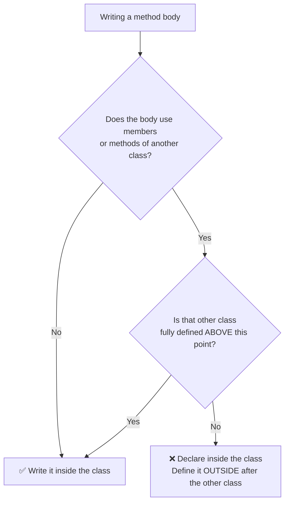
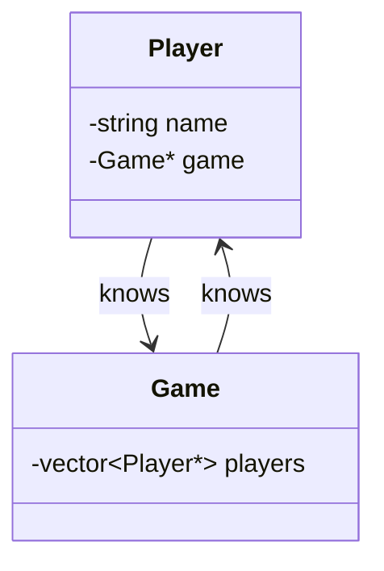
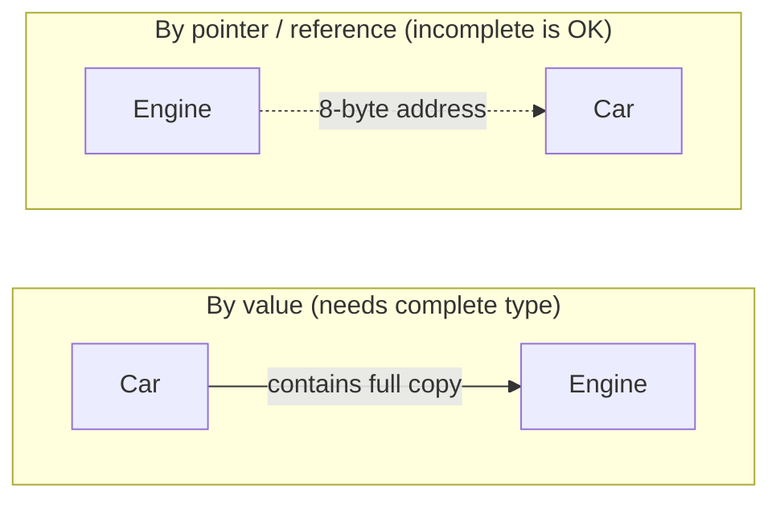
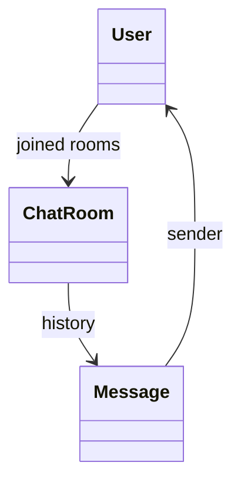
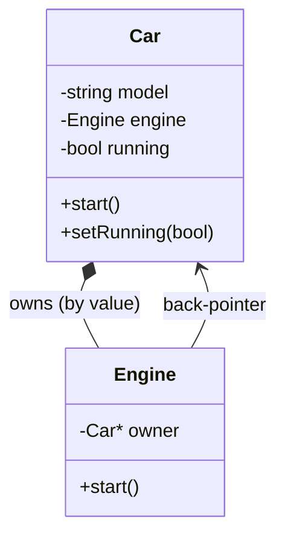
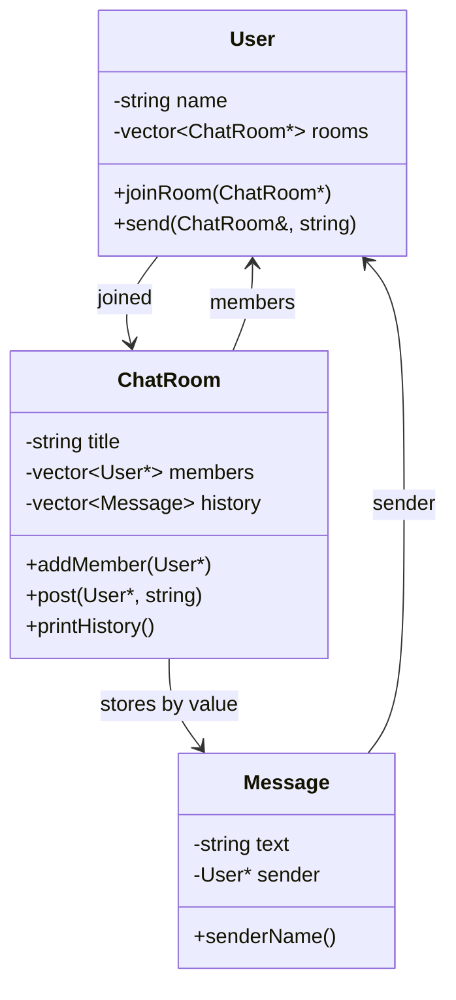
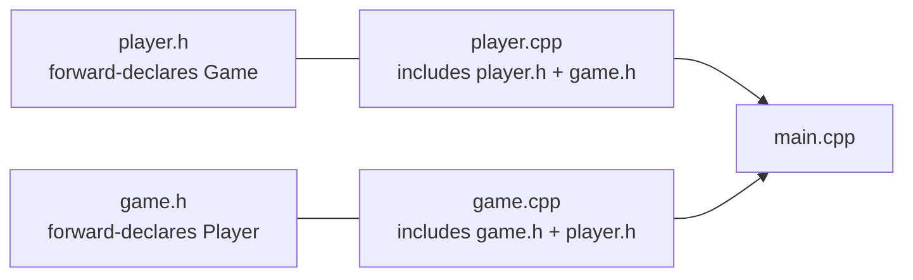
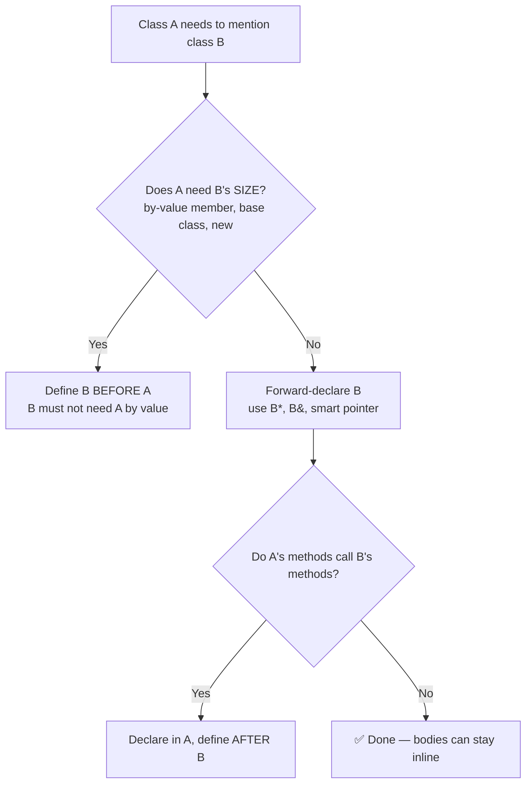

# Forward Declarations in C++ — A Complete Guide for LLD Interviews

> **Goal:** Understand what a forward declaration is, what you can and cannot do with an *incomplete* class, and how to use it to solve circular dependencies in Low-Level Design (LLD) problems.

**How to read the code blocks in this guide**

- `// [compiles]` → a complete program. You can copy it into a file and compile it with `g++ -std=c++17`.
- `// [error]` → intentionally wrong code. It will **not** compile. The error is explained right after it.
- Blocks with neither tag are small fragments used to explain a point.

---

## Table of Contents

0. [Two ideas you must know first](#0-two-ideas-you-must-know-first)
1. [What is a forward declaration?](#1-what-is-a-forward-declaration)
2. [How to write a forward declaration](#2-how-to-write-a-forward-declaration)
3. [What you can and cannot do with a forward-declared class](#3-what-you-can-and-cannot-do-with-a-forward-declared-class)
4. [Defining a class that uses a forward-declared class](#4-defining-a-class-that-uses-a-forward-declared-class)
5. [When and where to define methods](#5-when-and-where-to-define-methods)
6. [Circular dependencies](#6-circular-dependencies)
7. [Practical LLD examples](#7-practical-lld-examples)
8. [Best practices](#8-best-practices)
9. [Quick-reference table](#9-quick-reference-table)
10. [Common interview questions](#10-common-interview-questions)
11. [Practice exercises with solutions](#11-practice-exercises-with-solutions)

---

## 0. Two ideas you must know first

Before forward declarations make sense, you need two pairs of words.

### 0.1 Declaration vs Definition (for a class)

| | Class **declaration** | Class **definition** |
|---|---|---|
| Looks like | `class Engine;` | `class Engine { int hp; public: void start(); };` |
| Tells the compiler | "A class called `Engine` exists." | "Here is exactly what `Engine` contains." |
| Compiler knows the size? | ❌ No | ✅ Yes |
| Compiler knows the members/methods? | ❌ No | ✅ Yes |
| How many times allowed? | Many times | Only **once** per translation unit |

### 0.2 Incomplete type vs Complete type

- After only a declaration (`class Engine;`), `Engine` is an **incomplete type**. The compiler knows the *name*, nothing else.
- After the definition (`class Engine { ... };`), `Engine` is a **complete type**. The compiler knows its size and members.

> **Mental model:** An incomplete type is like a **name on a door** with no room behind it. You can point at the door (pointer, reference), but you can't walk in (use members) or ask how big the room is (`sizeof`).

The compiler reads your file **top to bottom, once**. It only knows what it has already seen. That single fact is the reason forward declarations exist.

---

## 1. What is a forward declaration?

A **forward declaration** tells the compiler: *"A class with this name exists. I'll show you its full definition later."*

```cpp
class Engine;   // <-- forward declaration (no body, ends with a semicolon)
```

### 1.1 The problem it solves

Look at this code. `Car` wants to hold a pointer to an `Engine`, but `Engine` is defined *after* `Car`.

```cpp
// [error]
class Car {
    Engine* engine_;      // ❌ the compiler has never heard of "Engine"
};

class Engine {
public:
    void start() {}
};

int main() {}
```

GCC reports something like:

```
error: 'Engine' does not name a type
```

The compiler reads top to bottom. When it reaches `Engine* engine_;`, it hasn't seen the word `Engine` yet.

**"Just swap the order!"** works here, but not always (see circular dependencies in section 6). So first, the fix with a forward declaration:

```cpp
// [compiles]
class Engine;             // ✅ "Engine exists, details later"

class Car {
    Engine* engine_;      // ✅ OK: a pointer to an incomplete type is allowed
public:
    Car() : engine_(nullptr) {}
};

class Engine {
public:
    void start() {}
};

int main() {
    Car c;
}
```

### 1.2 Why a pointer is fine but an object is not

To create a pointer, the compiler only needs to know that the type **exists**. Every pointer on a machine has the same size (e.g. 8 bytes), no matter what it points to.

To create an object, the compiler must know the **size** of the class so it can reserve memory. An incomplete type has no known size.

### 1.3 What forward declarations are used for (summary)

1. **Breaking circular dependencies** between classes (the main LLD use case).
2. **Reordering** — using a class name before its definition appears.
3. **Faster builds** — in header files, forward-declaring avoids `#include`-ing a whole header, so fewer files get recompiled when something changes.

---

## 2. How to write a forward declaration

### 2.1 Basic syntax

```cpp
class ClassName;     // for classes
struct StructName;   // for structs
```

Rules:

- It must end with a semicolon `;`.
- No body (`{ }`), no members.
- You can write it **as many times as you want** (it is just a declaration).
- Use the same keyword as the definition (`class` ↔ `class`, `struct` ↔ `struct`). Mixing them still compiles in most compilers, but MSVC warns, and it confuses readers.

### 2.2 Several forward declarations together

```cpp
class User;
class ChatRoom;
class Message;
```

Each line is independent. There is no "multiple forward declaration in one line" syntax.

### 2.3 A complete example

```cpp
// [compiles]
#include <iostream>

class Engine;    // forward declaration #1
class Engine;    // forward declaration #2 — repeating is harmless

class Car {
    Engine* engine_ = nullptr;
public:
    void setEngine(Engine* e) { engine_ = e; }   // only copies the pointer ✅
    bool hasEngine() const { return engine_ != nullptr; }
};

class Engine {                                    // <-- the definition (once only)
public:
    void start() { std::cout << "Engine started\n"; }
};

int main() {
    Engine e;
    Car c;
    c.setEngine(&e);
    std::cout << std::boolalpha << c.hasEngine() << "\n";   // true
}
```

### 2.4 Other things you can forward-declare

```cpp
template <typename T> class Stack;   // a class template
enum class Status;                   // scoped enum (underlying type defaults to int) ✅
enum Color : int;                    // unscoped enum — must give the underlying type
```

Things you **cannot** or **should not** forward-declare:

| Thing | Why not |
|---|---|
| A nested class from outside (`class Outer::Inner;`) | Not allowed by the language. Define the nested class inside `Outer`, or make `Inner` a top-level class. |
| Standard library types (`namespace std { class string; }`) | Undefined behavior. Include `<string>`, or use `<iosfwd>` for stream types. |

### 2.5 Declaration vs definition, side by side

```cpp
class Engine;                  // DECLARATION — incomplete type

class Engine {                 // DEFINITION — complete type
    int horsePower_;
public:
    void start();              // method declaration (inside the class)
};

void Engine::start() {}        // method DEFINITION (outside the class)
```

---

## 3. What you can and cannot do with a forward-declared class

Suppose we only have:

```cpp
class Engine;     // incomplete type from here on
```

Until the full definition of `Engine` appears, here is the complete list.

### 3.1 ✅ Allowed

| Operation | Example | Why it's allowed |
|---|---|---|
| Declare a pointer | `Engine* e;` | Pointer size doesn't depend on `Engine`. |
| Declare a reference | `Engine& e = ...;` | A reference is basically a pointer under the hood. |
| Set a pointer to `nullptr` | `Engine* e = nullptr;` | No knowledge of `Engine` required. |
| Copy / assign / compare pointers | `p1 = p2; if (p1 == p2)` | Just copying addresses. |
| Take the address of an existing object | `Engine* p = &someEngine;` | Only possible if `someEngine` is a complete object elsewhere. |
| Declare a function that takes/returns `Engine` **by value** | `void tune(Engine e);` `Engine make();` | A **declaration** only names the types. |
| Pass/return pointers and references in functions | `void tune(Engine* e);` `Engine& get();` | Pointers and references are fine. |
| Use it in `std::vector<Engine*>`, `std::shared_ptr<Engine>` as a type name | `std::vector<Engine*> list;` | The element type is a pointer, which is complete. |
| Create a type alias | `using EnginePtr = Engine*;` | Just a new name. |

### 3.2 ❌ Not allowed (until the class is fully defined)

| Operation | Example | Why it fails |
|---|---|---|
| Create an object | `Engine e;` | Compiler doesn't know the size. |
| Allocate with `new` | `new Engine();` | Needs size and constructor. |
| Use `sizeof` | `sizeof(Engine)` | Size unknown. |
| Access a member | `p->horsePower_` | Compiler doesn't know the members. |
| Call a method | `p->start();` | Compiler doesn't know the methods. |
| Dereference to use the object | `Engine copy = *p;` | Needs size and copy constructor. |
| Be a by-value data member | `class Car { Engine e; };` | Car's size would be unknown. |
| Be a base class | `class Turbo : public Engine {};` | Derived must know the base's layout. |
| Call a function by value | `tune(someEngine);` (the *call* needs completeness) | Must copy the object. |
| Safely `delete` it | `delete p;` | Undefined behavior if the real destructor is non-trivial; compilers warn. |

Now each failure, with the error and the fix.

### 3.3 Cannot create an object

```cpp
// [error]
class Engine;

int main() {
    Engine e;      // ❌
}
```

```
error: aggregate 'Engine e' has incomplete type and cannot be defined
```

**Fix:** provide the full definition before this line.

```cpp
// [compiles]
class Engine {};   // definition first

int main() {
    Engine e;      // ✅
}
```

### 3.4 Cannot access members or call methods

```cpp
// [error]
class Engine;

void run(Engine* e) {
    e->start();    // ❌ the compiler has no idea whether Engine even has start()
}
```

```
error: invalid use of incomplete type 'class Engine'
```

**Fix:** either move the body of `run` **below** the definition of `Engine`, or define `Engine` first.

```cpp
// [compiles]
class Engine;                  // forward declaration

void run(Engine* e);           // ✅ declaration: just uses a pointer

class Engine {
public:
    void start() {}
};

void run(Engine* e) {          // ✅ definition AFTER Engine is complete
    e->start();
}

int main() {
    Engine e;
    run(&e);
}
```

### 3.5 Cannot use `sizeof`

```cpp
// [error]
class Engine;
constexpr unsigned long n = sizeof(Engine);   // ❌
```

```
error: invalid application of 'sizeof' to incomplete type 'Engine'
```

### 3.6 Pointers and references are OK — but only to *hold*, not to *use*

```cpp
// [compiles]
class Engine;                       // incomplete

Engine* makePointer(Engine* p) {    // ✅ return and take pointers
    Engine* copy = p;               // ✅ copy pointer
    if (copy == nullptr) return nullptr;   // ✅ compare pointer
    return copy;
}

Engine& pass(Engine& r) {           // ✅ references too
    return r;
}

int main() {}
```

### 3.7 Functions declared with by-value parameters

A function **declaration** can mention an incomplete type by value, but the **definition** and any **call** need the complete type.

```cpp
// [compiles]
class Engine;

void tune(Engine e);       // ✅ declaration only
Engine build();            // ✅ declaration only

class Engine {             // now complete
public:
    int hp = 100;
};

void tune(Engine e) {      // ✅ definition after Engine is complete
    e.hp += 10;
}

Engine build() {
    return Engine();
}

int main() {
    Engine e = build();
    tune(e);
}
```

> **Rule of thumb:** *Naming* an incomplete type is fine. *Looking inside it, copying it, or sizing it* is not.

### 3.8 Cannot inherit from a forward-declared class

```cpp
// [error]
class Engine;
class TurboEngine : public Engine {};    // ❌
```

```
error: invalid use of incomplete type 'class Engine'
```

The derived class contains the base class as a sub-object, so the base must be complete.

### 3.9 `delete` on an incomplete type — a silent trap

```cpp
class Engine;

void destroy(Engine* p) {
    delete p;    // ⚠️ compiles with a warning; if Engine has a non-trivial
                 // destructor, the destructor is NOT called (undefined behavior)
}
```

Never rely on this. Make sure `Engine` is complete wherever you call `delete`.

---

## 4. Defining a class that uses a forward-declared class

Now the interesting part: *inside the body of another class*, what can you do with the forward-declared `Engine`?

### 4.1 Summary table

Assume `class Engine;` is forward-declared and `Engine` is **not yet defined** when `Car` is written.

| Inside `class Car { ... };` | Allowed? | Reason |
|---|---|---|
| `Engine* engine_;` | ✅ | Pointer. |
| `Engine& engine_;` | ✅ | Reference (must be bound in the constructor's initializer list). |
| `Engine engine_;` | ❌ | Size of `Car` would be unknown. |
| `std::vector<Engine*> engines_;` | ✅ | Vector of pointers. |
| `std::vector<Engine> engines_;` | ⚠️ | Allowed since C++17 only if `Engine` is complete before you *use* the vector. Beginners should avoid it. |
| `std::shared_ptr<Engine> engine_;` | ✅ | `shared_ptr` handles incomplete types. |
| `std::unique_ptr<Engine> engine_;` | ⚠️ | Allowed, **but** Car's destructor/constructors must be defined where `Engine` is complete (see 4.5). |
| `void setEngine(Engine* e);` (declaration) | ✅ | Pointer parameter. |
| `void setEngine(Engine e);` (declaration) | ✅ | Declaration only. Defining it needs a complete type. |
| `Engine* getEngine() const { return engine_; }` | ✅ | Only returns the pointer. |
| `void setEngine(Engine* e) { engine_ = e; }` | ✅ | Only copies the pointer. |
| `void start() { engine_->start(); }` | ❌ | Calls a method of an incomplete type. |
| `class Car : public Engine {};` | ❌ | Base class must be complete. |

### 4.2 Pointer member ✅

```cpp
// [compiles]
class Engine;

class Car {
    Engine* engine_ = nullptr;       // ✅
public:
    void attach(Engine* e) { engine_ = e; }   // ✅ copies a pointer
    Engine* engine() const { return engine_; }  // ✅ returns a pointer
};

class Engine {};

int main() {
    Engine e;
    Car c;
    c.attach(&e);
}
```

### 4.3 Reference member ✅

```cpp
// [compiles]
class Engine;

class Car {
    Engine& engine_;                            // ✅ reference member
public:
    explicit Car(Engine& e) : engine_(e) {}     // ✅ must be initialised here
};

class Engine {};

int main() {
    Engine e;
    Car c(e);
}
```

> References can't be reseated and can't be null, so for optional or changeable relationships, prefer a pointer.

### 4.4 Object (by-value) member ❌

```cpp
// [error]
class Engine;

class Car {
    Engine engine_;     // ❌ field has incomplete type
};
```

```
error: field 'engine_' has incomplete type 'Engine'
```

**Fix (option A) — define `Engine` before `Car`:**

```cpp
// [compiles]
class Engine {
public:
    void start() {}
};

class Car {
    Engine engine_;                      // ✅ Engine is complete
public:
    void start() { engine_.start(); }
};

int main() {
    Car c;
    c.start();
}
```

**Fix (option B) — keep the forward declaration and hold a pointer instead** (as in 4.2).

> **Design hint for LLD:** "Car **has an** Engine and the Engine's life is tied to the Car" → composition → by-value member (so `Engine` must be defined first). "Car **knows about** an Engine" → association → pointer.

### 4.5 Smart-pointer members and the destructor trap

`std::shared_ptr<Engine>` works with an incomplete type. `std::unique_ptr<Engine>` also *compiles* as a member, but it has a catch: the code that **destroys** the `unique_ptr` must see the complete `Engine`. If `Car`'s destructor is implicitly generated where `Engine` is still incomplete, you get an error.

```cpp
// [error]
#include <memory>

class Engine;

class Car {
    std::unique_ptr<Engine> engine_;   // OK as a declaration...
};

int main() {
    Car c;     // ❌ ...but creating/destroying Car needs Engine to be complete
}
```

```
error: invalid application of 'sizeof' to incomplete type 'Engine'
```

**Fix:** declare the constructor and destructor in the class, and define them after `Engine` is complete.

```cpp
// [compiles]
#include <iostream>
#include <memory>

class Engine;

class Car {
    std::unique_ptr<Engine> engine_;
public:
    Car();          // declared here
    ~Car();         // declared here
    void start();
};

class Engine {
public:
    void start() { std::cout << "Vroom\n"; }
};

Car::Car() : engine_(std::make_unique<Engine>()) {}   // ✅ Engine complete here
Car::~Car() = default;                                // ✅ Engine complete here
void Car::start() { engine_->start(); }

int main() {
    Car c;
    c.start();
}
```

### 4.6 Methods that *declare* an incomplete type ✅ vs *use* it ❌

```cpp
class Engine;

class Car {
    Engine* engine_ = nullptr;
public:
    void setEngine(Engine* e);   // ✅ declaration
    Engine* getEngine() const;   // ✅ declaration
    void start();                // ✅ declaration — body will use Engine, so it's defined later
};
```

The **declarations** are always fine. The question is where you write the **body**. That's the next section.

---

## 5. When and where to define methods

### 5.1 The rule

> A method **body** can use members of a forward-declared class **only if** the full definition of that class has already appeared **before the body**.

A method defined *inside* the class body is **not** treated as being after the other classes that come later in the file. So a body that needs `Engine`'s members must be moved out of the class and written after `Engine`'s definition.

### 5.2 The wrong way (inline body)

```cpp
// [error]
class Engine;

class Car {
    Engine* engine_ = nullptr;
public:
    void start() {
        engine_->start();    // ❌ Engine is still incomplete here
    }
};

class Engine {
public:
    void start() {}
};
```

```
error: invalid use of incomplete type 'class Engine'
```

Why doesn't C++ "look ahead"? Methods defined inside their *own* class can see all of that class's members (even ones declared below them). But that look-ahead is limited to **the same class**. It does not extend to other classes defined later in the file.

### 5.3 The right way — declare inside, define outside

**Step 1:** declare the method inside `Car`.
**Step 2:** define `Engine` fully.
**Step 3:** define `Car::start()` below `Engine`.

```cpp
// [compiles]
#include <iostream>

class Engine;                         // Step 0: forward declaration

class Car {
    Engine* engine_ = nullptr;
public:
    void setEngine(Engine* e) { engine_ = e; }   // ✅ only copies a pointer
    void start();                                // Step 1: declaration only
};

class Engine {                                   // Step 2: complete definition
public:
    void start() { std::cout << "Engine running\n"; }
};

void Car::start() {                              // Step 3: definition, Engine is complete
    if (engine_) engine_->start();               // ✅
}

int main() {
    Engine e;
    Car c;
    c.setEngine(&e);
    c.start();
}
```

### 5.4 The same rule in header files

If you define the method in a header (not a `.cpp`), mark it `inline`, otherwise including the header in two `.cpp` files breaks the One Definition Rule.

```cpp
// car.h (fragment)
inline void Car::start() {
    if (engine_) engine_->start();
}
```

### 5.5 Decision flow: "Can I write this method body inside the class?"



### 5.6 What if the body only *copies* the pointer?

```cpp
void setEngine(Engine* e) { engine_ = e; }   // ✅ fine inline
```

This is fine because assigning a pointer never needs to look inside `Engine`. The rule is about **looking inside** (calling methods, accessing members, `sizeof`, `new`, creating objects).

### 5.7 Inside a single class, order doesn't matter

```cpp
// [compiles]
class Counter {
public:
    void incrementTwice() {
        increment();          // ✅ increment() is declared later in the same class
        increment();
    }
    void increment() { ++count_; }
private:
    int count_ = 0;
};

int main() {
    Counter c;
    c.incrementTwice();
}
```

Inside a class, method bodies can use members declared further down. That is a special rule for the class's own members only.

---

## 6. Circular dependencies

### 6.1 What is a circular dependency?

Two (or more) classes need each other:

- `Player` needs to know its `Game`.
- `Game` needs to know its `Player`s.



Whichever class you write first needs the name of the one written second.

### 6.2 The broken version

```cpp
// [error]
#include <string>
#include <vector>

class Player {
    std::string name_;
    Game* game_;                  // ❌ 'Game' has not been seen yet
};

class Game {
    std::vector<Player*> players_;
};
```

```
error: 'Game' does not name a type
```

**Swapping the order doesn't help** — `Game` would then be missing `Player`. That's the whole problem: no ordering satisfies both classes.

### 6.3 The fix — one forward declaration

```cpp
// [compiles]
#include <string>
#include <vector>

class Game;                        // ✅ forward declaration breaks the cycle

class Player {
    std::string name_;
    Game* game_ = nullptr;         // ✅ pointer to incomplete type
public:
    explicit Player(std::string name) : name_(std::move(name)) {}
};

class Game {
    std::vector<Player*> players_; // ✅ Player is complete here (could be vector<Player> too)
public:
    void add(Player* p) { players_.push_back(p); }
};

int main() {
    Player p("Asha");
    Game g;
    g.add(&p);
}
```

### 6.4 The rule for breaking cycles

In a cycle of classes, **at least one link must be a pointer or reference** (not by-value). Forward-declare the class on the "pointer" side.

Here's a quick visual of what "by value" vs "by pointer" means:



### 6.5 Both classes holding each other **by value** is impossible

```cpp
// [error]
class B;

class A {
    B b;      // A contains B...
};

class B {
    A a;      // ...and B contains A: infinite size!
};
```

Even with perfect forward declarations, this can never work. `A` would contain `B`, which contains `A`, which contains `B`, and so on forever. This is a **design** error, not a syntax one. The fix is to change at least one side to a pointer, reference, or smart pointer.

### 6.6 Circular dependency with methods

The classic issue: both classes also want to **call each other's methods**.

```cpp
// [error]
class Game;

class Player {
    Game* game_;
public:
    void scorePoint() {
        game_->onScore(this);    // ❌ Game is incomplete here
    }
};

class Game {
public:
    void onScore(Player* p) { /* ... */ }
};
```

Fix with the **3-step recipe**:

1. Forward-declare.
2. Define both classes with method **declarations** only (for anything that needs the other class).
3. Define those methods **after both classes**.

```cpp
// [compiles]
#include <iostream>
#include <string>
#include <vector>

class Game;                                 // 1. forward declaration

class Player {
    std::string name_;
    int score_ = 0;
    Game* game_ = nullptr;
public:
    explicit Player(std::string name) : name_(std::move(name)) {}
    void joinGame(Game* g);                 // declared only (will call Game's methods)
    void scorePoint();                      // declared only
    const std::string& name() const { return name_; }
    int score() const { return score_; }
};

class Game {                                // 2. full definition
    std::vector<Player*> players_;
public:
    void addPlayer(Player* p) { players_.push_back(p); }
    void onScore(const Player& p) {         // ✅ Player is complete here
        std::cout << p.name() << " now has " << p.score() << " point(s)\n";
    }
};

void Player::joinGame(Game* g) {            // 3. definitions, both classes are complete
    game_ = g;
    game_->addPlayer(this);
}

void Player::scorePoint() {
    ++score_;
    if (game_) game_->onScore(*this);
}

int main() {
    Game g;
    Player a("Asha"), b("Ravi");
    a.joinGame(&g);
    b.joinGame(&g);
    a.scorePoint();
    a.scorePoint();
    b.scorePoint();
}
```

Output:

```
Asha now has 1 point(s)
Asha now has 2 point(s)
Ravi now has 1 point(s)
```

### 6.7 Cycles with three or more classes



`User → ChatRoom → Message → User` is a cycle. Fix: forward-declare `User` and `ChatRoom` near the top, and write the pieces that need to *look inside* other classes after all classes are defined. This is exactly what happens in section 7.2.

---

## 7. Practical LLD examples

### 7.1 `Car` and `Engine` (two-way link)

**Requirement:** A `Car` has an `Engine`. When the `Engine` starts, it must be able to tell the `Car` (for example, to update the dashboard).

**Design decisions**

- `Car` **owns** the `Engine` → composition → `Engine` is a **by-value member**, so `Engine` is defined **first**.
- `Engine` needs a **back-pointer** to its owner → `Car*` → forward-declare `Car`.



```cpp
// [compiles]
#include <iostream>
#include <string>

class Car;                                   // forward declaration

class Engine {
    Car* owner_;                             // ✅ back-pointer, Car is incomplete
public:
    explicit Engine(Car* owner) : owner_(owner) {}
    void start();                            // body needs Car's methods → define later
};

class Car {
    std::string model_;
    Engine engine_;                          // ✅ Engine is complete → by-value member
    bool running_ = false;
public:
    explicit Car(std::string model) : model_(std::move(model)), engine_(this) {}
    void start() { engine_.start(); }        // ✅ Engine is complete
    void setRunning(bool r) { running_ = r; }
    const std::string& model() const { return model_; }
    bool running() const { return running_; }
};

void Engine::start() {                       // defined AFTER Car is complete
    std::cout << "Engine starting...\n";
    owner_->setRunning(true);                // ✅ Car is complete here
}

int main() {
    Car c("Swift");
    c.start();
    std::cout << c.model() << " running? " << std::boolalpha << c.running() << "\n";
}
```

> ⚠️ **Tip:** `Car` stores `Engine` by value and passes `this` to it. If you ever copy or move a `Car`, the engine's `owner_` would still point to the *old* car. In real code, delete the copy constructor (`Car(const Car&) = delete;`) or use `unique_ptr` — a typical LLD "gotcha" worth mentioning in interviews.

### 7.2 `User`, `ChatRoom`, `Message` (three-class cycle)

**Requirements**

- A `Message` knows its sender (a `User`).
- A `ChatRoom` stores members (`User*`) and message history (`Message`).
- A `User` remembers which rooms they joined and can send messages.



**Plan**

1. Forward-declare `User` and `ChatRoom`.
2. Define `Message` first (holds `User*` only), then `User`, then `ChatRoom`.
3. Put bodies that need to *look inside* another class below all three definitions.

```cpp
// [compiles]
#include <iostream>
#include <string>
#include <utility>
#include <vector>

class User;        // forward declarations
class ChatRoom;

class Message {
    std::string text_;
    User* sender_;                                    // ✅ pointer to incomplete type
public:
    Message(std::string text, User* sender)
        : text_(std::move(text)), sender_(sender) {}
    const std::string& text() const { return text_; }
    std::string senderName() const;                   // needs User's methods → later
};

class User {
    std::string name_;
    std::vector<ChatRoom*> rooms_;                    // ✅ vector of pointers
public:
    explicit User(std::string name) : name_(std::move(name)) {}
    const std::string& name() const { return name_; }
    void joinRoom(ChatRoom* room);                    // needs ChatRoom's methods → later
    void send(ChatRoom& room, const std::string& text);   // later
};

class ChatRoom {
    std::string title_;
    std::vector<User*> members_;                      // ✅ pointers
    std::vector<Message> history_;                    // ✅ Message is complete → by value OK
public:
    explicit ChatRoom(std::string title) : title_(std::move(title)) {}
    void addMember(User* u) { members_.push_back(u); }        // ✅ only stores pointer
    void post(User* from, const std::string& text) {
        history_.emplace_back(text, from);                    // ✅ Message is complete
    }
    void printHistory() const {
        std::cout << "== " << title_ << " ==\n";
        for (const Message& m : history_) {
            std::cout << m.senderName() << ": " << m.text() << "\n";
        }
    }
};

// ---- Definitions that need both classes to be complete ----

std::string Message::senderName() const { return sender_->name(); }   // User is complete

void User::joinRoom(ChatRoom* room) {
    rooms_.push_back(room);
    room->addMember(this);                                 // ChatRoom is complete
}

void User::send(ChatRoom& room, const std::string& text) {
    room.post(this, text);
}

int main() {
    User alice("Alice"), bob("Bob");
    ChatRoom room("C++ Study Group");

    alice.joinRoom(&room);
    bob.joinRoom(&room);

    alice.send(room, "Hi everyone!");
    bob.send(room, "Hello Alice");
    room.printHistory();
}
```

Output:

```
== C++ Study Group ==
Alice: Hi everyone!
Bob: Hello Alice
```

**Why this works**

| Place | What it uses | Complete when needed? |
|---|---|---|
| `Message::sender_` | `User*` | Pointer only ✅ |
| `User::rooms_` | `vector<ChatRoom*>` | Pointer only ✅ |
| `ChatRoom::history_` | `vector<Message>` | `Message` defined above ✅ |
| `Message::senderName()` body | `sender_->name()` | Defined after `User` ✅ |
| `User::joinRoom()` body | `room->addMember()` | Defined after `ChatRoom` ✅ |

### 7.3 Observer pattern (a very common LLD use case)

The observer interface refers to the subject, and the subject stores observers.

```cpp
// [compiles]
#include <iostream>
#include <vector>

class Subject;                                   // forward declaration

class Observer {
public:
    virtual ~Observer() = default;
    virtual void update(Subject& s) = 0;         // ✅ reference to incomplete type
};

class Subject {
    std::vector<Observer*> observers_;
    int state_ = 0;
public:
    void attach(Observer* o) { observers_.push_back(o); }
    void setState(int s) {
        state_ = s;
        for (Observer* o : observers_) o->update(*this);   // Observer is complete ✅
    }
    int state() const { return state_; }
};

class Display : public Observer {
public:
    void update(Subject& s) override {                      // Subject is complete here ✅
        std::cout << "Display sees state = " << s.state() << "\n";
    }
};

int main() {
    Subject subject;
    Display d;
    subject.attach(&d);
    subject.setState(42);
}
```

### 7.4 Splitting into header and source files (how real projects do it)

In a multi-file project, forward declarations are most valuable in **headers**. Each header only forward-declares what it needs; the `.cpp` files include the full headers.

```cpp
// file: player.h
#pragma once
#include <string>

class Game;                       // forward declaration — no #include "game.h" needed

class Player {
    std::string name_;
    int score_ = 0;
    Game* game_ = nullptr;
public:
    explicit Player(std::string name);
    void joinGame(Game* g);
    void scorePoint();
    const std::string& name() const;
    int score() const;
};
```

```cpp
// file: game.h
#pragma once
#include <vector>

class Player;                     // forward declaration

class Game {
    std::vector<Player*> players_;
public:
    void addPlayer(Player* p);
    void onScore(const Player& p);
};
```

```cpp
// file: player.cpp
#include "player.h"
#include "game.h"                 // full definition needed here, because we call Game's methods
#include <utility>

Player::Player(std::string name) : name_(std::move(name)) {}
void Player::joinGame(Game* g) { game_ = g; game_->addPlayer(this); }
void Player::scorePoint() { ++score_; if (game_) game_->onScore(*this); }
const std::string& Player::name() const { return name_; }
int Player::score() const { return score_; }
```

```cpp
// file: game.cpp
#include "game.h"
#include "player.h"               // full definition needed here, because we call Player's methods
#include <iostream>

void Game::addPlayer(Player* p) { players_.push_back(p); }
void Game::onScore(const Player& p) {
    std::cout << p.name() << " now has " << p.score() << " point(s)\n";
}
```

```cpp
// file: main.cpp
#include "game.h"
#include "player.h"

int main() {
    Game g;
    Player a("Asha"), b("Ravi");
    a.joinGame(&g);
    b.joinGame(&g);
    a.scorePoint();
    b.scorePoint();
}
```

Build it with:

```
g++ -std=c++17 main.cpp player.cpp game.cpp -o game
```



Neither header includes the other, so there's no circular `#include`. This is the cleanest way to solve the problem in real projects.

> **Why not just `#include "game.h"` inside `player.h` and vice versa?** Circular includes lead to the compiler seeing one class before the other is defined, which gives the same "does not name a type" errors. Include guards (`#pragma once`) stop infinite recursion, but they don't magically reorder the definitions.

### 7.5 How this appears in an LLD interview

You are usually asked to design something like a Parking Lot, Chat Application, Library System, Chess/Tic-Tac-Toe, or Elevator system. The classes naturally refer to each other:

| LLD problem | Cycle | Typical fix |
|---|---|---|
| Chat app | `User` ↔ `ChatRoom` ↔ `Message` | Forward-declare `User`, `ChatRoom`; use `User*` in `Message`. |
| Tic-Tac-Toe / Chess | `Player` ↔ `Game` ↔ `Board` | `Player` holds `Game*`; `Game` holds players/board. |
| Library | `Member` ↔ `Book` (borrowed / borrower) | `Book` stores `Member*`, `Member` stores `Book*`. |
| Parking lot | `ParkingLot` ↔ `Floor` ↔ `Spot` ↔ `Vehicle` | Child holds raw/weak pointer to parent; parent owns children. |
| Observer / pub-sub | `Subject` ↔ `Observer` | Forward-declare `Subject` in the observer interface. |
| Elevator | `Elevator` ↔ `Controller` | Elevator holds `Controller*` for callbacks. |

**What to say out loud in an interview:**
"These two classes reference each other. I'll forward-declare one, hold a pointer on that side, and define the method bodies that need both classes after both definitions."

---

## 8. Best practices

### 8.1 Do

1. **Prefer forward declaration over `#include` in headers** when a pointer or reference is enough. It reduces compile times and avoids circular includes.
2. **Include the full header in the `.cpp` file** where you actually use the class's members.
3. **Declare in the class, define after** when a method body needs another class's members.
4. **Parent owns child (by value or `unique_ptr`); child holds a plain pointer/reference back to parent.** It's a good ownership rule and helps break cycles.
5. **Use `shared_ptr` and `weak_ptr` carefully for cycles.** If A holds a `shared_ptr<B>` and B holds a `shared_ptr<A>`, neither is ever freed (memory leak). Make the back-link a `weak_ptr` (or a raw non-owning pointer if the lifetime is guaranteed).
6. **Put the destructor in the `.cpp`** when a class holds a `unique_ptr<Incomplete>` as a member.
7. **Use `#pragma once`** (or include guards) in every header.
8. **Use the same keyword (`class`/`struct`)** in the declaration as in the definition.

### 8.2 Don't

1. ❌ Don't forward-declare when you need the **size** (by-value members, base classes, `new`).
2. ❌ Don't forward-declare standard library types. Use `<iosfwd>` for streams, otherwise include the header.
3. ❌ Don't try to use a forward-declared class's members in an inline method body — define it later.
4. ❌ Don't create circular **by-value** containment. It's impossible; redesign it.
5. ❌ Don't `delete` through a pointer to an incomplete type.
6. ❌ Don't use a forward declaration just to "make an error go away". First ask whether the design really needs a two-way link. Sometimes an interface (abstract base class) or an event/callback removes the cycle entirely.

### 8.3 Choosing between pointer types in LLD

| Relationship | Typical member | Notes |
|---|---|---|
| Owns (lifetime tied) | by value or `std::unique_ptr<T>` | By value requires a complete type. |
| Shared ownership | `std::shared_ptr<T>` | Watch for cycles. |
| Non-owning, may change or be null | `T*` | Simple and fine for LLD. |
| Non-owning, never null, never changes | `T&` | Must be set in the constructor. |
| Non-owning back-link to a shared object | `std::weak_ptr<T>` | Breaks `shared_ptr` cycles. |

### 8.4 Checklist before you write code in an interview



---

## 9. Quick-reference table

| Question | With only `class T;` (incomplete) | After `class T { ... };` (complete) |
|---|---|---|
| Declare `T* p;` | ✅ | ✅ |
| Declare `T& r;` | ✅ | ✅ |
| Declare `T obj;` | ❌ | ✅ |
| Member `T obj;` in another class | ❌ | ✅ |
| `std::vector<T*>` member | ✅ | ✅ |
| `std::vector<T>` member | ⚠️ (C++17, only if complete before use) | ✅ |
| `std::shared_ptr<T>` member | ✅ | ✅ |
| `std::unique_ptr<T>` member | ⚠️ (destructor must see complete `T`) | ✅ |
| `p->member` / `p->method()` | ❌ | ✅ |
| `new T` | ❌ | ✅ |
| `delete p` | ⚠️ UB if non-trivial destructor | ✅ |
| `sizeof(T)` | ❌ | ✅ |
| Inherit from `T` | ❌ | ✅ |
| Function **declaration** `void f(T);` | ✅ | ✅ |
| Function **definition/call** with `T` by value | ❌ | ✅ |
| Copy/compare/null-assign `T*` | ✅ | ✅ |
| Dereference `*p` to use the object | ❌ | ✅ |
| Cast `static_cast<Derived*>(p)` | ❌ | ✅ |

**One-line memory trick:** With an incomplete type you can **name it, point at it, refer to it** — but you cannot **size it, build it, open it, or inherit it**.

---

## 10. Common interview questions

**Q1. What is the difference between a class declaration and a class definition?**
A declaration (`class A;`) only introduces the name; the type stays incomplete. A definition (`class A { ... };`) lists the members and makes the type complete. You can declare many times but define only once per translation unit.

**Q2. Why can I declare a pointer to a forward-declared class but not an object?**
A pointer has a fixed size regardless of the target type, so the compiler doesn't need to see inside the class. An object needs its size and layout, which only the full definition provides.

**Q3. Why can't I call `p->method()` on a forward-declared class?**
The compiler doesn't know whether the method exists, what it takes, or what it returns. It needs the definition to check and generate the call.

**Q4. My method body fails inside the class but works outside. Why?**
Inside the class, the other class is still incomplete at that point in the file. Move the body out of the class and put it after the other class's definition.

**Q5. Can two classes contain each other by value?**
No. Each would contain an infinite chain of the other. At least one must hold a pointer, reference, or smart pointer, and that class is the one whose target you forward-declare.

**Q6. Can I inherit from a forward-declared class?**
No. A derived class needs the full layout of its base.

**Q7. How do forward declarations help compile time?**
If a header only needs a pointer or reference to `Foo`, forward-declaring `Foo` avoids `#include "foo.h"`. Changing `foo.h` then no longer recompiles every file that includes this header.

**Q8. Why does `std::unique_ptr<Impl>` need the destructor in the `.cpp` file?**
`unique_ptr`'s destructor calls `delete` on the stored pointer, which needs `Impl` to be complete. If the class's implicit destructor is generated in a place where `Impl` is incomplete, compilation fails. Declaring the destructor in the class and defining it (`= default`) in the `.cpp` fixes it.

**Q9. What happens if you `delete` a pointer to an incomplete type?**
If the real class has a non-trivial destructor, it's undefined behavior (the destructor may not run). Compilers usually warn.

**Q10. How would you resolve a `shared_ptr` circular reference between `Parent` and `Child`?**
Parent holds `shared_ptr<Child>`; Child holds `weak_ptr<Parent>`. Forward-declare as needed, and lock the `weak_ptr` when you need to use the parent.

**Q11. In the Observer pattern, how do you avoid circular dependencies between `Observer` and `Subject`?**
Forward-declare `Subject` in the observer interface and take `Subject&` in `update()`. Concrete observers (defined after `Subject`) can then use the subject's methods.

**Q12. Can you forward-declare a nested class or `std::string`?**
No to both: nested classes can't be forward-declared from outside, and forward-declaring standard library types is undefined behavior. Include the proper header (or `<iosfwd>` for streams).

---

## 11. Practice exercises with solutions

Try each exercise before opening the solution.

### Exercise 1 — Fix the compile error

```cpp
// [error]
#include <string>
#include <vector>

class Department {
    std::string name_;
    std::vector<Employee*> staff_;
};

class Employee {
    std::string name_;
    Department* dept_;
public:
    Employee(std::string n, Department* d) : name_(n), dept_(d) {}
};
```

<details>
<summary>Solution</summary>

`Employee` is used inside `Department` before being declared. Forward-declare it (a pointer is enough).

```cpp
// [compiles]
#include <string>
#include <vector>

class Employee;                                   // ✅ forward declaration

class Department {
    std::string name_;
    std::vector<Employee*> staff_;                // pointer: fine
public:
    explicit Department(std::string n) : name_(std::move(n)) {}
    void hire(Employee* e) { staff_.push_back(e); }
};

class Employee {
    std::string name_;
    Department* dept_;
public:
    Employee(std::string n, Department* d) : name_(std::move(n)), dept_(d) {
        dept_->hire(this);                        // ✅ Department is complete here
    }
};

int main() {
    Department d("Engineering");
    Employee e("Meera", &d);
}
```

</details>

### Exercise 2 — Library system

Write `Book` and `Member` classes where:

- A `Book` stores the `Member*` who borrowed it (or `nullptr`).
- A `Member` stores the list of `Book*` they borrowed.
- `Member::borrow(Book&)` should update **both** sides and print a message.
- A book that's already borrowed can't be borrowed again.

<details>
<summary>Solution</summary>

```cpp
// [compiles]
#include <algorithm>
#include <iostream>
#include <string>
#include <vector>

class Member;                                     // forward declaration

class Book {
    std::string title_;
    Member* borrower_ = nullptr;
public:
    explicit Book(std::string title) : title_(std::move(title)) {}
    const std::string& title() const { return title_; }
    bool isAvailable() const { return borrower_ == nullptr; }
    void setBorrower(Member* m) { borrower_ = m; }    // ✅ pointer copy only
};

class Member {
    std::string name_;
    std::vector<Book*> borrowed_;
public:
    explicit Member(std::string name) : name_(std::move(name)) {}
    const std::string& name() const { return name_; }
    bool borrow(Book& b) {
        if (!b.isAvailable()) {
            std::cout << b.title() << " is already borrowed\n";
            return false;
        }
        b.setBorrower(this);                      // ✅ Member is being defined; "this" works
        borrowed_.push_back(&b);
        std::cout << name_ << " borrowed " << b.title() << "\n";
        return true;
    }
};

int main() {
    Book b("Clean Code");
    Member m1("Asha"), m2("Ravi");
    m1.borrow(b);
    m2.borrow(b);
}
```

Notice that `Book` only *stores* a `Member*`, so no method of `Member` is called from `Book`. No out-of-class definition was needed. If `Book` had a method `printBorrowerName()` calling `borrower_->name()`, you would declare it inside `Book` and define it after `Member`.

</details>

### Exercise 3 — Method that needs the other class

Extend Exercise 2: add `void Book::printBorrower() const` that prints the name of the borrower (or `"nobody"`).

<details>
<summary>Solution</summary>

```cpp
// [compiles]
#include <iostream>
#include <string>
#include <vector>

class Member;

class Book {
    std::string title_;
    Member* borrower_ = nullptr;
public:
    explicit Book(std::string title) : title_(std::move(title)) {}
    void setBorrower(Member* m) { borrower_ = m; }
    void printBorrower() const;                   // declared only — needs Member::name()
};

class Member {
    std::string name_;
    std::vector<Book*> borrowed_;
public:
    explicit Member(std::string name) : name_(std::move(name)) {}
    const std::string& name() const { return name_; }
    void borrow(Book& b) { b.setBorrower(this); borrowed_.push_back(&b); }
};

void Book::printBorrower() const {                // defined AFTER Member
    if (borrower_) std::cout << "Borrowed by " << borrower_->name() << "\n";
    else           std::cout << "Borrowed by nobody\n";
}

int main() {
    Book b("Clean Code");
    Member m("Asha");
    b.printBorrower();
    m.borrow(b);
    b.printBorrower();
}
```

</details>

### Exercise 4 — Will it compile?

Assume only `class Engine;` has been declared, with no definition yet. For each line, say ✅ or ❌ and why.

```cpp
class Engine;

(a) Engine* p = nullptr;
(b) Engine& r = *p;
(c) Engine e;
(d) void tune(Engine* e);
(e) void tune2(Engine e);          // declaration only
(f) void run(Engine* e) { e->start(); }
(g) class Car { Engine e; };
(h) class Car { Engine* e; };
(i) class Turbo : public Engine {};
(j) using EnginePtr = Engine*;
(k) std::size_t n = sizeof(Engine);
(l) std::vector<Engine*> v;
```

<details>
<summary>Solution</summary>

| Line | Result | Reason |
|---|---|---|
| (a) | ✅ | Pointer to incomplete type. |
| (b) | ⚠️ ✅ compiles | Forming a reference from `*p` doesn't need the complete type (but dereferencing a null `p` is undefined behavior at runtime). |
| (c) | ❌ | Object of incomplete type. |
| (d) | ✅ | Pointer parameter. |
| (e) | ✅ | Function *declaration* may use an incomplete type by value. |
| (f) | ❌ | `e->start()` needs the complete type. |
| (g) | ❌ | By-value member needs size. |
| (h) | ✅ | Pointer member. |
| (i) | ❌ | Base class must be complete. |
| (j) | ✅ | Alias for a pointer type. |
| (k) | ❌ | `sizeof` of incomplete type. |
| (l) | ✅ | Vector of pointers; element type is complete. |

</details>

### Exercise 5 — Design a Tic-Tac-Toe skeleton

Create `Player`, `Board`, and `Game` where:

- `Player` has a name and a symbol (`char`), and a `Game*` it belongs to.
- `Board` is a 3×3 grid of `char` with `place(row, col, symbol)`.
- `Game` owns the `Board` (by value) and two `Player*`s.
- `Player::makeMove(row, col)` asks the game to place a move: `game_->placeMove(*this, row, col)`.

<details>
<summary>Solution</summary>

`Game` needs `Player` details and `Board` (complete); `Player` only needs a `Game*`, so forward-declare `Game`. `Player::makeMove` calls a `Game` method, so it's defined after `Game`.

```cpp
// [compiles]
#include <iostream>
#include <string>

class Game;                                          // forward declaration

class Player {
    std::string name_;
    char symbol_;
    Game* game_ = nullptr;
public:
    Player(std::string name, char symbol) : name_(std::move(name)), symbol_(symbol) {}
    void setGame(Game* g) { game_ = g; }
    const std::string& name() const { return name_; }
    char symbol() const { return symbol_; }
    void makeMove(int row, int col);                 // needs Game::placeMove → later
};

class Board {
    char cells_[3][3];
public:
    Board() {
        for (auto& row : cells_)
            for (char& c : row) c = '.';
    }
    bool place(int r, int c, char s) {
        if (r < 0 || r > 2 || c < 0 || c > 2 || cells_[r][c] != '.') return false;
        cells_[r][c] = s;
        return true;
    }
    void print() const {
        for (const auto& row : cells_) {
            for (char c : row) std::cout << c << ' ';
            std::cout << "\n";
        }
    }
};

class Game {
    Board board_;                                    // ✅ Board is complete → by value
    Player* p1_;
    Player* p2_;
public:
    Game(Player* a, Player* b) : p1_(a), p2_(b) {
        p1_->setGame(this);                          // ✅ Player is complete here
        p2_->setGame(this);
    }
    void placeMove(const Player& p, int r, int c) {
        if (board_.place(r, c, p.symbol()))
            std::cout << p.name() << " played (" << r << "," << c << ")\n";
        else
            std::cout << "Invalid move by " << p.name() << "\n";
        board_.print();
    }
};

void Player::makeMove(int row, int col) {            // after Game is complete
    if (game_) game_->placeMove(*this, row, col);
}

int main() {
    Player a("Asha", 'X'), b("Ravi", 'O');
    Game g(&a, &b);
    a.makeMove(1, 1);
    b.makeMove(1, 1);                                // invalid: already taken
    b.makeMove(0, 0);
}
```

</details>

### Exercise 6 — Think and explain (interview style)

*"In a Parking Lot design, `ParkingSpot` needs to tell its `Floor` when it becomes free, and `Floor` owns the list of spots. How do you write this in C++ without circular errors?"*

<details>
<summary>Solution</summary>

- `Floor` **owns** the spots → `std::vector<ParkingSpot>` (by value) → so `ParkingSpot` is defined **first**.
- `ParkingSpot` needs a back-link → `Floor*` → forward-declare `Floor`.
- `ParkingSpot::free()` calls `floor_->onSpotFreed(id_)` → declare in the class, define after `Floor`.

```cpp
// [compiles]
#include <iostream>
#include <vector>

class Floor;                                          // forward declaration

class ParkingSpot {
    int id_;
    bool occupied_ = false;
    Floor* floor_;                                    // back-pointer
public:
    ParkingSpot(int id, Floor* f) : id_(id), floor_(f) {}
    void park() { occupied_ = true; }
    void freeSpot();                                  // needs Floor → defined later
    bool occupied() const { return occupied_; }
    int id() const { return id_; }
};

class Floor {
    std::vector<ParkingSpot> spots_;                  // by value: ParkingSpot is complete
    int freeCount_ = 0;
public:
    explicit Floor(int n) {
        spots_.reserve(n);
        for (int i = 0; i < n; ++i) spots_.emplace_back(i, this);
        freeCount_ = n;
    }
    ParkingSpot& spot(int i) { return spots_[i]; }
    void onSpotTaken() { --freeCount_; }
    void onSpotFreed(int id) {
        ++freeCount_;
        std::cout << "Spot " << id << " is free. Free spots: " << freeCount_ << "\n";
    }
};

void ParkingSpot::freeSpot() {
    if (!occupied_) return;
    occupied_ = false;
    floor_->onSpotFreed(id_);                         // ✅ Floor is complete here
}

int main() {
    Floor f(3);
    f.spot(1).park();
    f.onSpotTaken();
    f.spot(1).freeSpot();
}
```

> `Floor` hands `this` to its spots, so a `Floor` shouldn't be copied or moved after construction (the spots would point at the old object). Mention this in the interview, and delete the copy operations if you want to be explicit.

</details>

---

## Final Summary

1. A **forward declaration** (`class X;`) introduces a name without a definition. `X` stays an **incomplete type** until the full definition appears.
2. With an incomplete type you can **declare pointers/references, pass them around, and declare functions** — but you can't create objects, use `sizeof`, access members, call methods, or inherit.
3. A class can hold a **pointer or reference** to an incomplete type, but not a by-value member.
4. If a method body needs to **look inside** a forward-declared class, **declare it in the class and define it after** the other class is complete.
5. **Circular dependencies** are solved by: forward-declare → pointers on at least one side → define the dependent methods after both classes.
6. In multi-file projects, **forward-declare in headers, include in `.cpp` files**.
7. In LLD interviews, the pattern is: *"Parent owns child; child keeps a non-owning pointer back; forward-declare the parent; define the child's methods that use the parent after the parent class."*